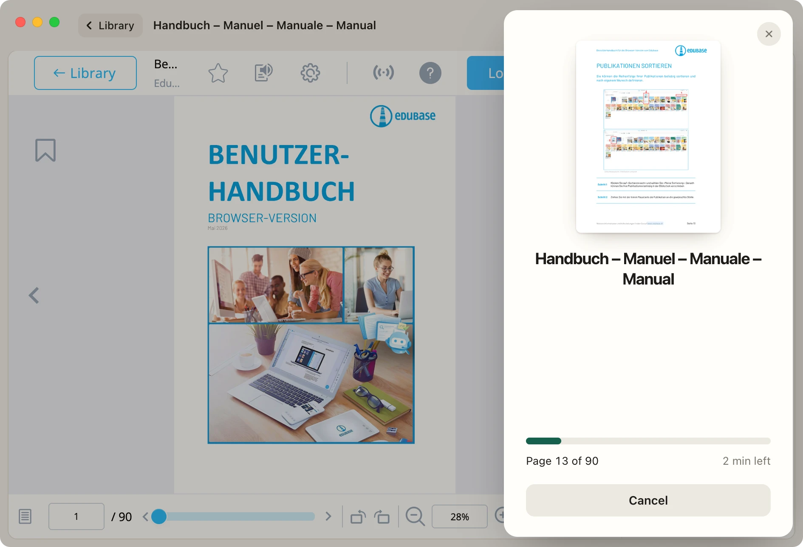

# Stapel

Your Edubase school books in their own window on Mac and Windows, and as a PDF when you need them offline.

<picture>
  <source media="(prefers-color-scheme: dark)" srcset="docs/library-dark.webp">
  
</picture>

- **Library.** Every book on your Edubase account, with its cover. One click opens it.
  Recently opened books come first.
- **Read.** Books open in Edubase's own reader, inside the app: notes, bookmarks and search
  work as on the website. No browser, no tabs.
- **Save as PDF.** Save a whole book or a range of pages as one PDF, to read offline or to write
  in with a notes app. Text stays text.
- **Sign in once.** You sign in on Edubase's own page, also with Office 365, Edulog, Google or
  Apple. The app never sees your password and stays signed in.
- English and German.

<picture>
  <source media="(prefers-color-scheme: dark)" srcset="docs/reader-dark.webp">
  
</picture>

<picture>
  <source media="(prefers-color-scheme: dark)" srcset="docs/pdf-dark.webp">
  
</picture>

The library picture uses sample covers. The others show Edubase's free user manual.

## Install

**Mac** (macOS 12 or later, Apple Silicon or Intel):

```sh
curl -fsSL https://github.com/KorelUyar/stapel/releases/latest/download/install.sh | zsh
```

This downloads the latest version, puts it in Applications and opens it. Stapel is not
notarised by Apple, so a copy downloaded with a browser needs one confirmation under
System Settings, Privacy & Security, Open Anyway.

**Windows** (10 and 11): download `Stapel-Windows-Setup.exe` from the
[latest release](https://github.com/KorelUyar/stapel/releases/latest) and run it. Windows shows
“Windows protected your PC” because the installer is not signed: choose More info, then Run
anyway. Stapel installs for your user only, no administrator needed.

You need an Edubase account. Without one you can look at Edubase's free books.

## Please note

Stapel is not made by Edubase and is not affiliated with it. It shows Edubase's own web
reader with your account. **Save as PDF only books you have a licence for, and keep the PDFs to
yourself.** Edubase's terms limit copies to what you personally need.

## How it works

Stapel is an Electron app. The reader is a `<webview>` of app.edubase.ch in its own session
(`persist:edubase`), locked to that site. For a PDF, a hidden window opens the book, waits until
each page has finished loading, prints it with Chromium's own PDF printer and merges the pages
with `pdf-lib`.

- `edubase.js` – sign-in window, library, saving a book as PDF
- `main.js` – window, reader lock-down, settings, IPC
- `preload.js` – the bridge the interface may call
- `ui/` – the interface (`i18n.js` holds all text)

```sh
npm install
npm start            # run from source
npm run dist         # Mac: dist/mac-universal/Stapel.app and dist/Stapel-macOS.zip
npm run dist:win     # Windows: dist/Stapel-Windows-Setup.exe (run on Windows)
node_modules/.bin/electron scripts/smoke.js <dir>              # end-to-end check, no account needed
node_modules/.bin/electron scripts/shots.js <dir> light|dark   # the pictures above
```

Every push builds the Windows installer on GitHub Actions and runs the end-to-end check there,
against the source and the packaged app, then installs it silently and starts it.

Edubase can change its website at any time. Everything Stapel relies on is in `edubase.js`
(`.lu-library-item`, `.lu-profile-settings__login`, `[data-item=page-settings]`,
`[data-action=footer-next-page]`).

## Licence

GPL-3.0. Started from [AndrinGautschi/edubase-book-downloader](https://github.com/AndrinGautschi/edubase-book-downloader).
