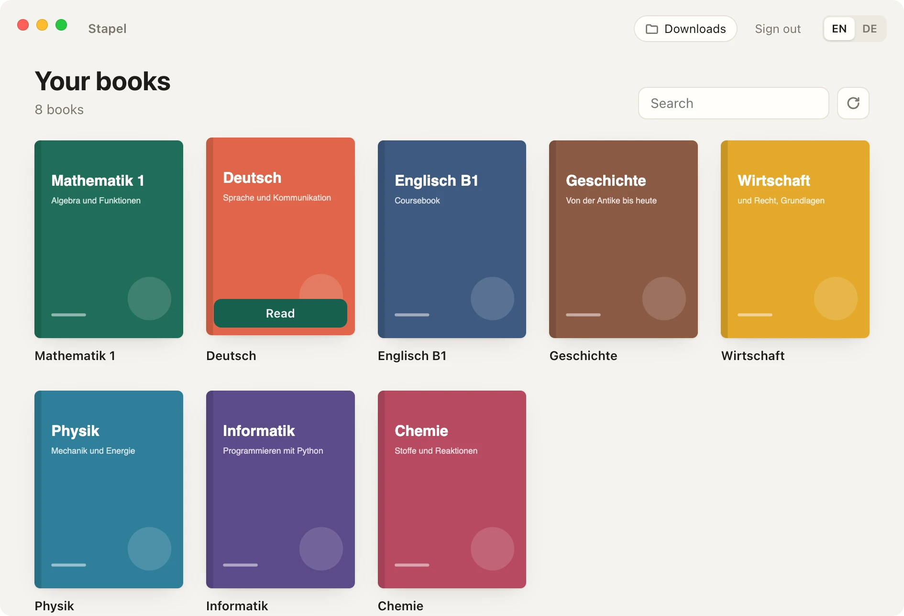
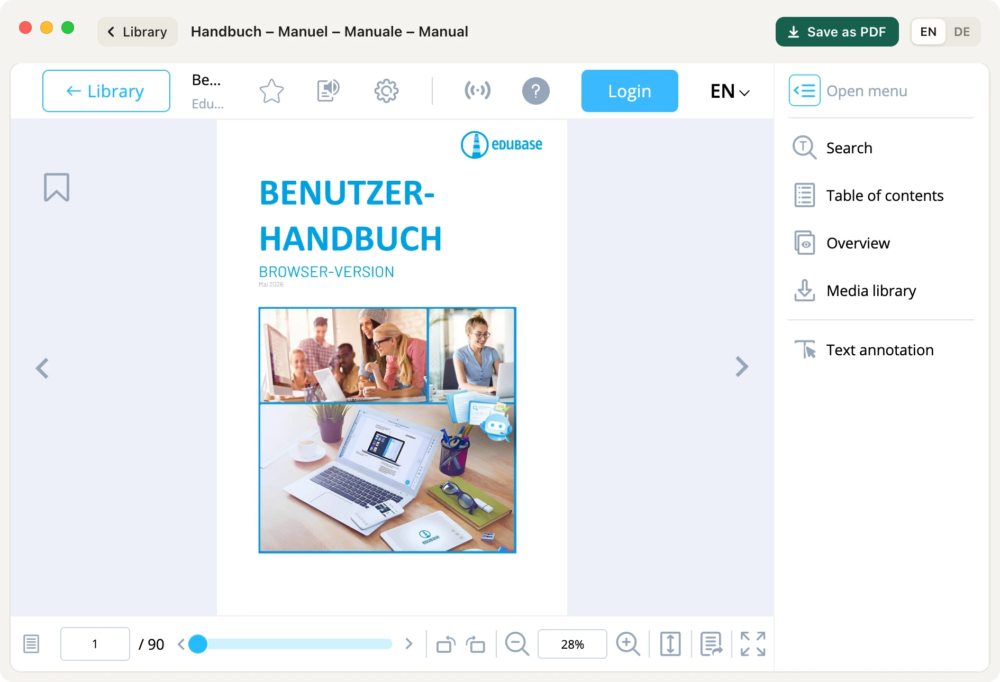
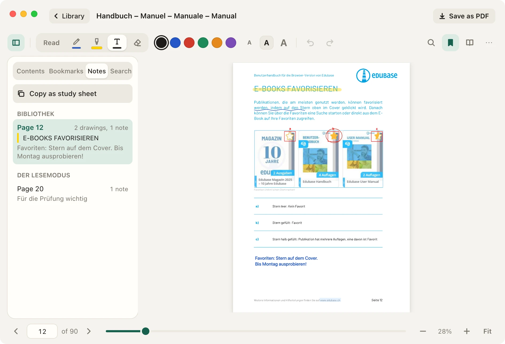
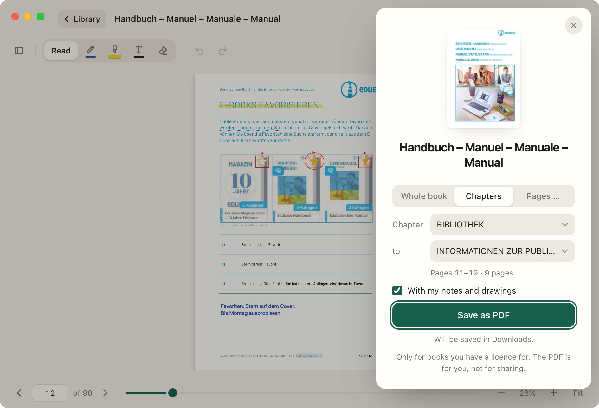
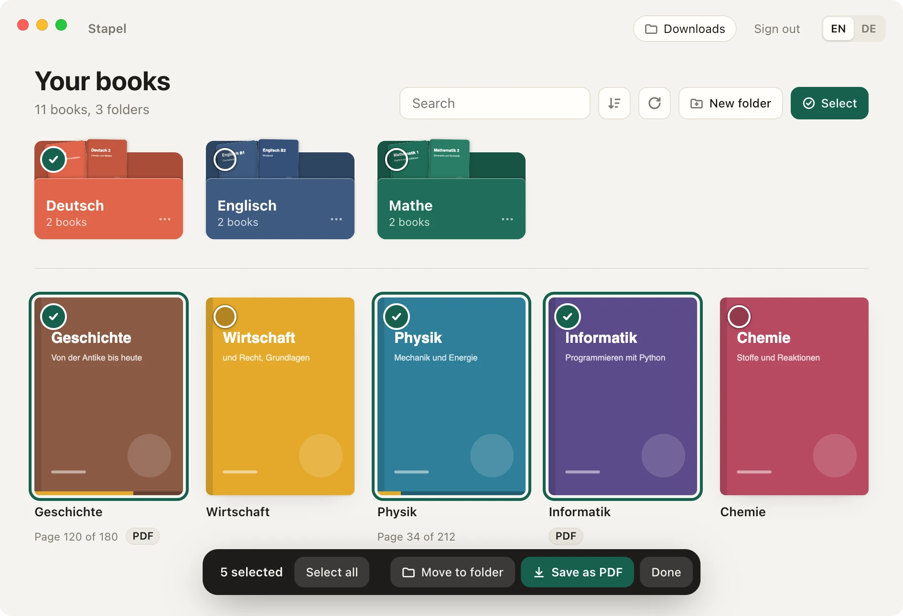
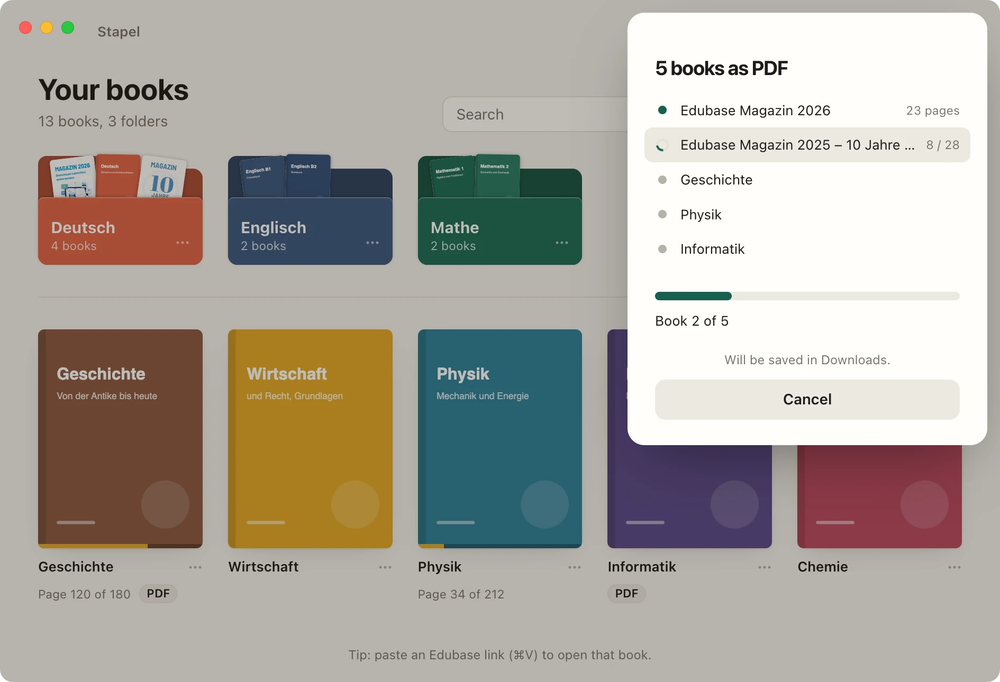

# Stapel

Your Edubase school books in their own app on Mac and Windows: sorted into folders, with your
own notes on the pages, and as PDFs when you need them offline.

<picture>
  <source media="(prefers-color-scheme: dark)" srcset="docs/library-dark.webp">
  
</picture>

- **Library with folders.** Every book on your Edubase account, with its cover. Make folders
  with your own names and colours (German, Maths, …) and drag books into them. The library
  shows how far you have read each book.
- **A reader of its own.** A book opens in Stapel's reader: table of contents, search,
  bookmarks, one or two pages, zoom. Scrolling turns one page per gesture.
- **Write on the pages.** Pen, highlighter, typed text and an eraser, with undo. What you mark
  with the highlighter is listed as text in the notes, chapter by chapter, and the whole list
  copies as a study sheet into Word, Pages, Notion or GoodNotes. Dark pages for reading at night.
- **Your notes, backed up.** Notes, bookmarks and folders stay on your computer, or in a folder
  you choose, such as iCloud Drive or OneDrive: then every computer that uses that folder has
  them. They are not sent to Edubase and do not appear in Edubase's own apps.
- **Save as PDF.** A whole book, some chapters, a range of pages, or many books in one go,
  sorted into folders like in the app. The PDF can be searched and its text copied, it has the
  book's table of contents and page numbers, and your notes can be printed into it.
- **Sign in once.** You sign in on Edubase's own page, also with Office 365, Edulog, Google or
  Apple. The app never sees your password and stays signed in.
- English and German.

<picture>
  <source media="(prefers-color-scheme: dark)" srcset="docs/reader-dark.webp">
  
</picture>

<picture>
  <source media="(prefers-color-scheme: dark)" srcset="docs/notes-dark.webp">
  
</picture>

<picture>
  <source media="(prefers-color-scheme: dark)" srcset="docs/chapters-dark.webp">
  
</picture>

<picture>
  <source media="(prefers-color-scheme: dark)" srcset="docs/select-dark.webp">
  
</picture>

<picture>
  <source media="(prefers-color-scheme: dark)" srcset="docs/batch-dark.webp">
  
</picture>

The library pictures use sample covers. The others show Edubase's free user manual and
magazines.

## Install

**Mac** (macOS 12 or later, Apple Silicon or Intel):

```sh
curl -fsSL https://github.com/KorelUyar/stapel/releases/latest/download/install.sh | zsh
```

This downloads the latest version, puts it in Applications and opens it. Stapel is not
notarised by Apple, so a copy downloaded with a browser needs one confirmation under
System Settings, Privacy & Security, Open Anyway.

**Windows** (10 and 11): download `Stapel-Windows-Setup.exe` from the
[latest release](https://github.com/KorelUyar/stapel/releases/latest) and run it. Windows shows
“Windows protected your PC” because the installer is not signed: choose More info, then Run
anyway. Stapel installs for your user only, no administrator needed.

You need an Edubase account. Without one you can look at Edubase's free books.

**Updates.** From version 1.2 on, Stapel looks on GitHub for a newer version when it starts.
If there is one, a button "Update to …" appears at the top. One click downloads the new
version, puts it in place of the old one and starts Stapel again; your books, folders and notes
stay as they are. Nothing is downloaded before that click. On a Mac this needs Stapel to be in
the Applications folder (where the line above puts it).

## Please note

Stapel is not made by Edubase and is not affiliated with it. The pages of a book are drawn by
Edubase's own web reader with your account; the rest of the reader is Stapel's. **Save as PDF
only books you have a licence for, and keep the PDFs to yourself.** Edubase's terms limit
copies to what you personally need.

Folders, reading positions, bookmarks and notes are Stapel's own and stay on your computer (in
the app's data folder), or in the folder you chose under Settings. Edubase does not know about
them. Notes made in Edubase's own reader are a separate thing: Stapel's tools do not change them.

With a chosen folder, two computers that use it at the same time each write their own changes;
when both change the same book at the same moment, the one that saves last wins for that book.
A folder that cannot be reached (a USB stick that is not plugged in) is not written to: new
notes stay on this computer until it is back, and are added to it then.

If Edubase changes its website and Stapel's reader stops working, the menu at the right end of
the reader's toolbar switches to Edubase's own view until Stapel is updated.

## How it works

Stapel is an Electron app. The reader is a `<webview>` of app.edubase.ch in its own session
(`persist:edubase`), locked to that site. Stapel hides Edubase's bars with a stylesheet and
runs a script in the page that reports what is on screen, takes commands from Stapel's toolbar
and draws the notes as an SVG layer over each page. For a PDF, a hidden window opens the book,
waits until each page has finished loading, draws the notes on it, lays Edubase's list of the
page's words over the letters as invisible text, prints it with Chromium's own PDF printer and
merges the pages with `pdf-lib`, adding the table of contents and the page numbers.

- `edubase.js` – sign-in window, library, saving a book as PDF
- `reader.js` – the reader's side in the main process: commands, notes on disk
- `reader/` – what runs inside Edubase's page (`inject.js`; `ink.js` draws the notes, `book.js`
  reads the table of contents and the words of a page) and the stylesheets
- `reader-preload.js` – the one channel from that page to the app
- `update.js` – looks for a newer release, downloads it, swaps it in
- `main.js` – window, reader lock-down, settings, folders, IPC
- `preload.js` – the bridge the interface may call
- `ui/` – the interface (`library.js`, `reader.js`, `pdf.js`, `settings.js`; `i18n.js` holds all
  text)

```sh
npm install
npm start            # run from source
npm run dist         # Mac: dist/mac-universal/Stapel.app and dist/Stapel-macOS.zip
npm run dist:win     # Windows: dist/Stapel-Windows-Setup.exe (run on Windows)
node_modules/.bin/electron scripts/smoke.js <dir>              # end-to-end check, no account needed
node_modules/.bin/electron scripts/shots.js <dir> light|dark   # the pictures above
```

Every push to `main` builds the Windows installer on GitHub Actions and runs the end-to-end
check there, against the source and the packaged app, then installs it silently, starts it,
and runs the installer once more over the running app, the way an update does.

How an update works: the app asks `github.com/KorelUyar/stapel/releases/latest` where it
points to, and reads the version from that address. The file comes from the same release.
On a Mac the new `Stapel.app` is unpacked next to the old one, its name, version and signature
are checked, and a small script swaps the two once the app has quit. On Windows the installer
of the new version runs without questions and starts the app again.

Edubase can change its website at any time. What Stapel relies on is in `edubase.js`
(`.lu-library-item`, `.lu-profile-settings__login`, `[data-item=page-settings]`,
`[data-action=footer-next-page]`) and in `reader/` (`.doc-page-wrapper`, `.lu-page-word` with
`data-w` and `data-pos`, `.lu-docpanel-toc`, `.lu-search-snippet`, the `data-action` buttons for
zoom and page mode, and the ids of the bars that are hidden).

## Licence

GPL-3.0. Started from [AndrinGautschi/edubase-book-downloader](https://github.com/AndrinGautschi/edubase-book-downloader).
